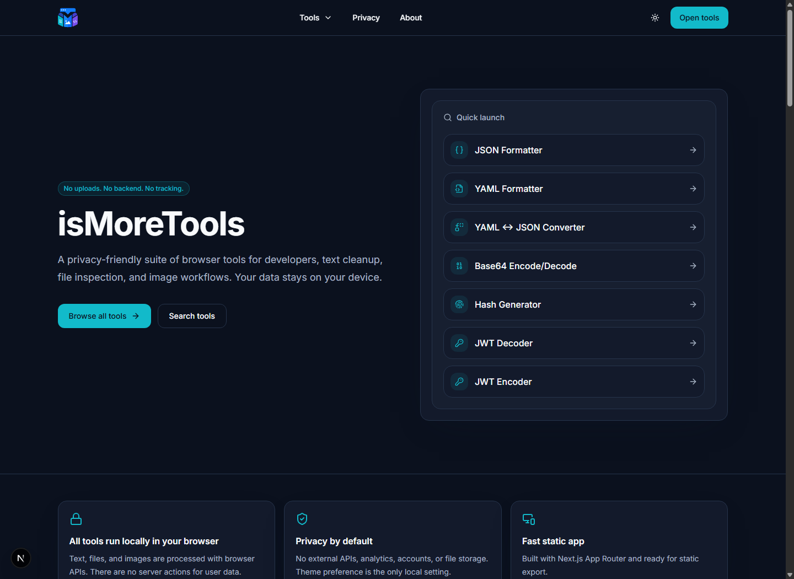
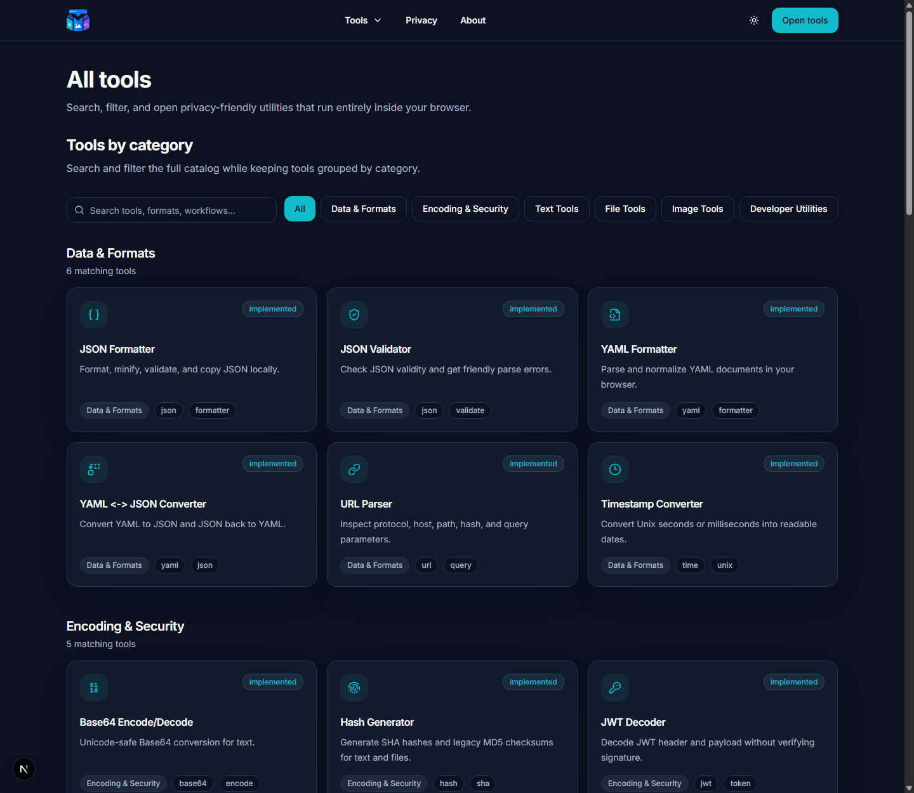
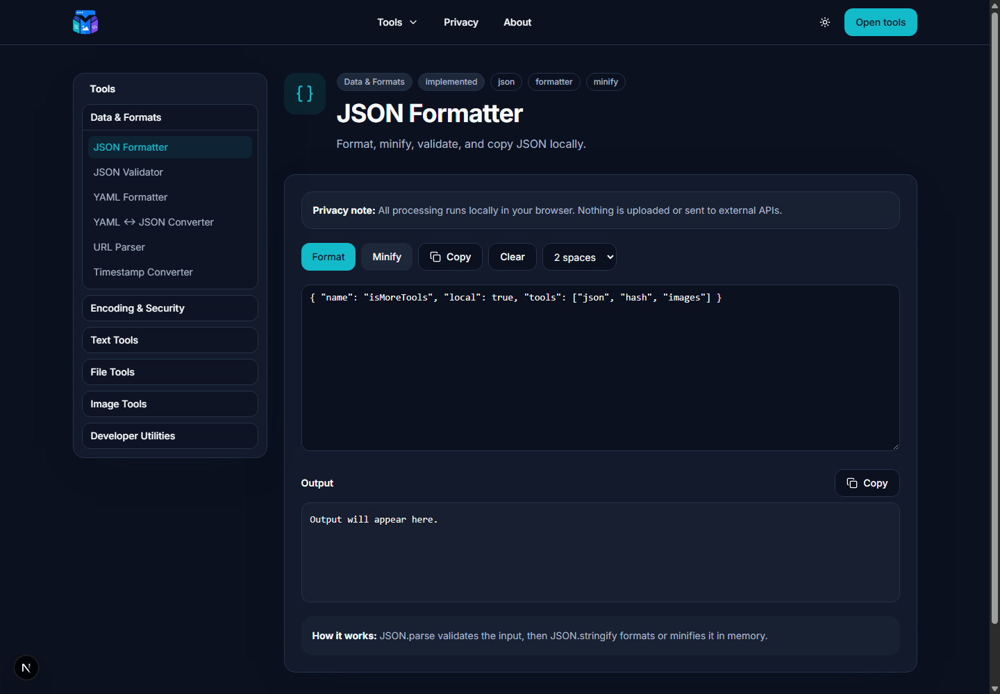
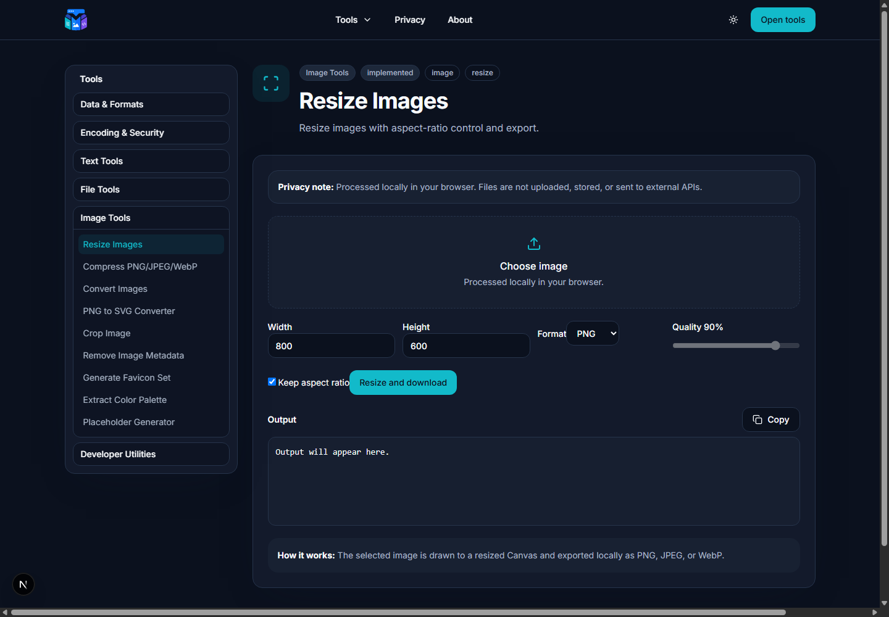

# isMoreTools

[](https://github.com/kwexz/isMoreTools/actions/workflows/ci.yml)

Privacy-friendly browser tools for developers, text, files, and images.

isMoreTools is a **static Next.js App Router** app with **no backend**. Every tool runs
entirely in your browser using the platform APIs (File, Canvas, Web Crypto, URL, Clipboard)
— there are no accounts, no uploads, no analytics, and no external processing APIs.

> **Main feature: your data never leaves your device.** Text, files, and images are read
> and processed locally, and downloads are generated on-device from Blob URLs.

## Screenshots

| Home | Tool catalog |
| --- | --- |
|  |  |
| **JSON Formatter** | **Resize Images** |
|  |  |

## Live demo

No public demo is hosted yet. The fastest way to try it is to run it locally
(see [Quick start](#quick-start)) — the app is a fully static export, so it also runs from
any static file server.

## What's inside

**39 working tools** across six categories, plus 2 catalog-only entries:

- **Data & Formats** — JSON Formatter, JSON Validator, YAML Formatter, YAML ↔ JSON Converter, URL Parser, Timestamp Converter
- **Encoding & Security** — Base64 Encode/Decode, Hash Generator (SHA-1/256/384/512 + legacy MD5), JWT Decoder, JWT Encoder (unsigned or HS256), UUID Generator
- **Text Tools** — Word/Character Counter, Clean Extra Spaces, Change Case, Transliteration, Slug Generator, Remove Duplicate Lines, Sort Lines, Extract Emails/URLs, Lorem Ipsum Generator
- **File Tools** — MIME Type Viewer, File Checksum Generator, Compare Two Files, Batch Rename Preview, Generate Checksum File
- **Image Tools** — Resize Images, Compress PNG/JPEG/WebP, Convert Images, PNG to SVG Converter, Crop Image, Remove Image Metadata, Generate Favicon Set, Extract Color Palette, Placeholder Generator
- **Developer Utilities** — Regex Tester, Regex Builder, Markdown Preview (sanitized), Rich Text to Markdown, Diff Checker

**Catalog-only (route and page exist, implementation planned):** Text Diff, File Size Converter.

## Tech stack

- [Next.js](https://nextjs.org/) 16 (App Router, `output: "export"` static export)
- TypeScript (strict) and React 19
- Tailwind CSS with shadcn-style UI primitives and `lucide-react` icons
- Local-processing libraries: `yaml`, `jose`, `diff`, `exifr`, `browser-image-compression`,
  `react-markdown` + `remark-gfm` + `rehype-sanitize`

## Quick start

Requirements: Node.js 22+ (matches CI and the Docker image).

```bash
npm ci        # install exact dependencies from package-lock.json
npm run dev   # start the dev server at http://localhost:3000
```

Build and preview the static output:

```bash
npm run build     # static export into out/
npm run start     # serve out/ locally (npx serve out)
```

## Privacy model

The privacy claim is verifiable in the source: there is no backend to send data to.

- User text, files, and images are never uploaded. Tools read them with File/Canvas/Web
  Crypto/URL/Clipboard APIs and produce results (and downloads) locally.
- No server actions, no API routes, no auth, no database, no analytics, no third-party
  scripts.
- `localStorage` is used only for the theme preference; uploaded or pasted content is not
  persisted.
- The only network activity is loading the app's **own** static assets from its own origin.
  The Inter font is fetched from Google Fonts **at build time** and then self-hosted by the
  app, so the browser requests no third-party origins at runtime.

See [`app/privacy`](app/privacy/page.tsx) for the in-app statement.

## Project structure

```text
app/          routes (App Router), layout, home, tools, about, privacy
components/    layout, tool UI, and tool implementations
data/tools.ts  the tool catalog (slug, category, status, tags)
lib/tools/     pure, dependency-light helpers (json, yaml, text, hash, files, images)
types/         shared TypeScript types
docs/          DEPLOYMENT.md and screenshots
```

## Deployment

The app is a static export served by Nginx. The recommended small-VPS setup builds `out/`
locally and runs a lightweight Nginx container bound to `127.0.0.1:8090`, with host Nginx
as the HTTPS reverse proxy. Full step-by-step instructions (server prep, Docker, the Nginx
site config, Let's Encrypt, updates, and `502` troubleshooting) are in
[`docs/DEPLOYMENT.md`](docs/DEPLOYMENT.md).

A multi-stage [`Dockerfile`](Dockerfile) and [`docker-compose.yml`](docker-compose.yml) are
also included for hosts that prefer to build the image directly.

## Verification

The repository is checked by [`CI`](.github/workflows/ci.yml) on every push and pull
request, running `npm ci`, `npm run typecheck`, `npm run lint`, and `npm run build`.

| Command | Checks |
| --- | --- |
| `npm run typecheck` | `tsc --noEmit` across the whole project |
| `npm run lint` | ESLint 9 (flat config via `eslint-config-next`) |
| `npm run build` | Production build; prerenders all 47 routes and exports `out/` |

## License

[MIT](LICENSE)
